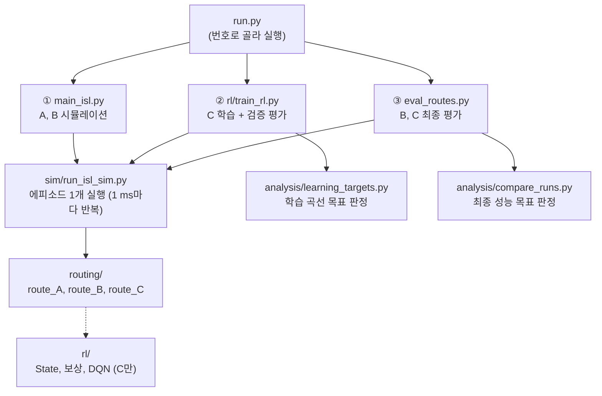
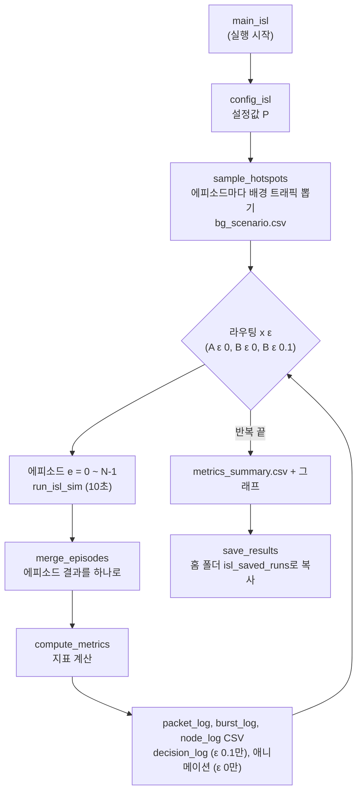
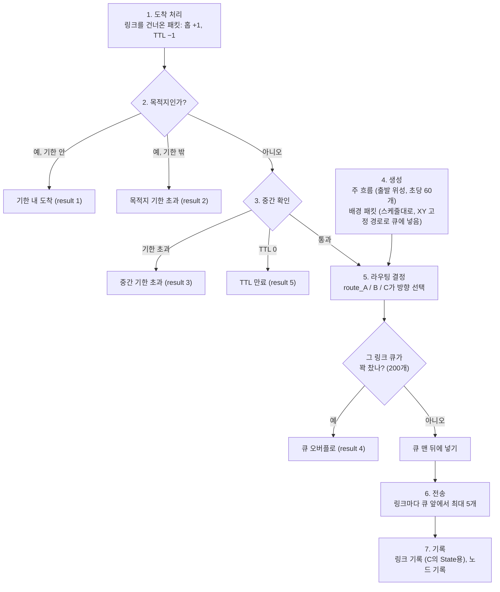
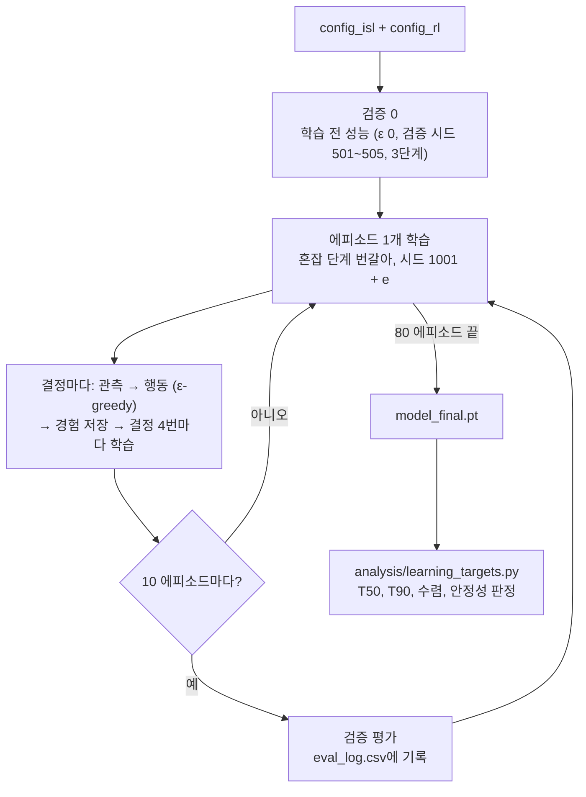

# 코드 흐름

ISL 라우팅 시뮬레이터(`isl_routing/`)가 **어떤 순서로, 어떤 파일을 거쳐** 돌아가는지 정리한 문서.
실행은 세 가지로 나뉨: ① A, B 시뮬레이션, ② C(강화학습) 학습, ③ B, C 최종 평가와 목표 판정.
모두 같은 시뮬레이터(`sim/run_isl_sim.py`)와 같은 배경 트래픽 규칙을 쓰고, 시드만 다름.

---

## 1. 전체 흐름 한눈에 보기

| 실행 | 시드 | 결과 |
| --- | --- | --- |
| ① `main_isl.py` | 시작 시드부터 에피소드 수만큼 (기본 1~20) | `~/isl_saved_runs/라우팅_혼잡단계_날짜/` |
| ② `rl/train_rl.py` | 학습 1001부터, 검증 501~505 | `~/rl_models/routeC_날짜_s학습시드/` |
| ③ `eval_routes.py` | 평가 1~20 | `~/isl_saved_runs/eval_날짜/` |

---

## 2. ① A, B 시뮬레이션 (`main_isl.py`)

- 같은 에피소드는 라우팅이 달라도 같은 배경 트래픽 → 공정한 비교
- 실행 인자: `python main_isl.py 시작시드 혼잡단계 라우팅 [모델경로]` (모두 생략 가능)

---

## 3. 에피소드 1개 실행 (`sim/run_isl_sim.py`, 핵심)

1 step = 1 ms. 큐가 빈 상태에서 시작해 `P.simTime`(10,000 step) 동안 아래를 반복하고, 남은 주 흐름 패킷이 모두 끝나면 종료.

| 단계 | 내용 |
| --- | --- |
| 1~3 | 도착한 패킷의 결과를 판정. C 학습 중이면 끝난 패킷의 보상을 경험 연결 장치(`rl_collector`)에 알림 |
| 4 | 배경 패킷을 주 흐름보다 먼저 큐에 넣음 (주 흐름 라우팅이 이번 step 부하까지 보고 판단) |
| 5 | 주 흐름 패킷마다 라우팅 호출, 결정 기록 1줄. C 학습 중이면 결정을 경험으로 연결 |
| 6 | 주 흐름과 배경이 같은 큐를 먼저 온 순서로 씀 (FIFO). 배경 패킷 생성, 큐 진입, 전송은 배열 연산으로 한꺼번에 처리 |
| 7 | `link_history`: 링크별 최근 큐 길이와 마지막 넘침 시각 (C의 큐 증가 속도, 최근 넘침, 이웃 부하 관측용) |

---

## 4. 배경 트래픽 (`sim/bg_event.py`, `P.bgMode = 'event'`)

주 흐름이 아닌, 일부러 혼잡을 만드는 패킷. XY 고정 경로로 보내고 지표 계산에서는 제외.

| 항목 | 값 |
| --- | --- |
| 기본 부하 | 모든 링크에 에피소드 내내 링크 용량의 0.1~0.4배 |
| 지역 핫스팟 발생 | 포아송 과정 (단계별 평균 간격) |
| 위치 | 핫스팟마다 중심 위성을 새로 뽑음. 출발 → 도착 대각선 1칸 이내 위성을 3배 더 자주 |
| 범위와 세기 | 중심 위성의 송신 링크에 +0.5~1.5배, 이웃 위성의 송신 링크에 그 절반 |
| 지속 시간 | 평균 1초 (지수분포), 끝나면 큐에 남은 패킷은 그대로 비워짐 |
| 안전장치 | 용량을 넘는(1.0배 이상) 링크를 모두 빼고도 출발 → 도착 길이 있어야 핫스팟을 만듦. 없으면 그 핫스팟은 건너뜀 |
| 혼잡 단계 | 발생 간격 평균 base 1초, high 0.5초, severe 0.25초 (동시에 걸린 지역 약 1, 2, 4개) |
| 시드 | 같은 시드면 같은 배경 트래픽이 다시 나옴 |

- 위치, 세기, 시점, 지속 시간이 모두 무작위라 강화학습이 특정 혼잡 패턴을 외울 수 없음
- 기존 방식(`P.bgMode = 'hotspot'`, `sim/bg_traffic.py`): 에피소드 시작에 핫스팟 2~7개를 뽑아 끝까지 고정, 켜짐과 꺼짐만 반복

---

## 5. 라우팅: 다음 방향 고르기 (`routing/`)

패킷이 위성에 도착할 때마다 호출. 입력(현재 위성, 큐 상태 등)과 출력(방향 1 상, 2 하, 3 좌, 4 우)이 같아서 `P.routeName`으로 바꿔 끼움.

| 라우팅 | 판단 방법 |
| --- | --- |
| `route_A` | 링크 지연 합이 최소인 경로 (Dijkstra). 큐는 보지 않음. 동점이면 좌/우 먼저 |
| `route_B` | DRA: 주 방향(목적지 쪽 좌/우) 송신 큐가 용량의 50% 미만이면 주 방향, 넘으면 보조 방향(목적지 쪽 상/하)이 여유 있을 때 보조로 |
| `route_C` | State 15개를 신경망에 넣어 Q값이 가장 큰 방향 (링크 없는 방향만 마스크로 막음). 학습 중에는 ε 확률로 무작위 |

---

## 6. ② C 학습 (`rl/train_rl.py`)

- 자세한 State, Action, Reward와 설정값은 [`isl_routing/rl/README.md`](isl_routing/rl/README.md)
- 학습 시드(신경망 초기값)를 바꿔 여러 번 돌림: `python rl/train_rl.py 80 0 0`, `... 0 1`, `... 0 2`

---

## 7. ③ 최종 평가와 목표 판정

| 판정 스크립트 | 판정 내용 |
| --- | --- |
| `learning_targets.py` | 학습 진행, T50 (전체의 20% 이후), T90 (40~70%), 평가 점 25개 이상, 급상승 15%p 이하, 수렴 (75% 이전), 수렴 뒤 하락 5%p 이하, 발산, 학습 시드 간 차이 3%p 이하 |
| `compare_runs.py` | B 대비 1분당 연속 손실 감소 (base 10%, high 20%, severe 20% 이상), 95번째 백분위 길이, 도착률 (B보다 1%p 넘게 낮지 않음, severe는 5%p 이상 높음), 지연 +5 ms 이내, 짝지은 승률 70% 이상, 95% 신뢰구간, 최악 에피소드, 이상 신호 |

---

## 8. 지표 계산 (`analysis/compute_metrics.py`, `burst_summary.py`)

모두 **주 흐름 패킷**만으로 계산.

| 지표 | 계산 |
| --- | --- |
| 기한 내 도착률 | 기한 내 도착 수 / 생성 수 |
| 손실률 | 1 − 기한 내 도착률 |
| 평균 지연 | 목적지에 도착한 패킷(기한 초과 도착 포함)의 (종료 − 생성) 평균 |
| 처리량 | 기한 내 도착 수 × 160 Byte × 8 / 총 시간 |
| 최대 연속 손실 | 패킷 번호 순서로 연달아 잃은 최대 개수 (에피소드 경계에서 끊음) |
| 연속 손실 횟수 | 3개 이상 이어진 손실 구간 수 |
| 1분당 연속 손실 횟수 | 연속 손실 횟수 / 시뮬레이션 분 |
| 연속 손실 길이 95번째 백분위 | 연속 손실 구간 길이의 상위 5% 지점 |
| 경로 변경 수, 평균 홉 수 | 도착 패킷 기준 |

---

## 9. 값 변경

| 바꿀 것 | 위치 |
| --- | --- |
| 망, 큐, 링크, 기한, 생성률 | `config_isl.py` (`P.queueMax`, `P.linkCapacity`, `P.deadline`, `P.genRate` 등) |
| 에피소드 길이, 평가 에피소드 수 | `config_isl.py` (`P.simTime`, `P.numEpisodes`) |
| 배경 트래픽 방식, 혼잡 단계 | `config_isl.py` (`P.bgMode`, `EVENT_LEVELS`, `P.bgBaseMin`, `P.evLoadMin` 등) |
| 망 구조 | 환경 변수 `ISL_TOPOLOGY` (`grid`, `grid:8x8`, `iridium`, `starlink`) |
| 강화학습 (학습률, ε, 버퍼, 검증 주기) | `rl/config_rl.py` |
| 결과 저장 경로 | 환경 변수 `ISL_SAVE_ROOT`, `RL_SAVE_ROOT` |

CSV 각 열의 의미는 [`csv.md`](csv.md) 참고.
