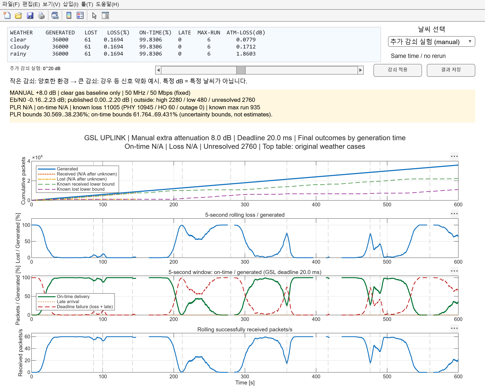

# 추가 감쇠 슬라이더 실험

기존 `main_gsl_simulation.m` 실행(F5) → **UDP SESSION PERFORMANCE** 창의 슬라이더를 0~20 dB로 이동하고 마우스를 놓습니다. 0.1 dB 단위로 반영합니다. 0 dB에서 시작하려면 **감쇠 적용**을 누릅니다. 별도 실행 파일은 필요 없습니다.

- 기준은 맑음 프로필의 기체 흡수입니다. 추가 감쇠만 더하며 구름·강우 프로필을 중복하지 않습니다. 기존 날씨 선택으로 돌아갈 수 있습니다. 상단 세 날씨 표는 기존 결과이며 슬라이더 결과가 아닙니다.
- 날씨 이름별 고정 dB 표는 사용하지 않습니다. 작은 감쇠=양호한 환경, 큰 감쇠=강우 등에 의한 신호 약화라는 설명용 예시입니다. 실제 날씨 분류·실측값이 아닙니다.
- 추가 감쇠만큼 수신 SNR/Eb/N0가 낮아집니다. 14 GHz·50 MHz·50 Mbps·QPSK/AR4JA와 궤도·핸드오버 일정은 유지합니다. 전송률을 감쇠에 따라 임의로 낮추지 않습니다.
- 매번 동일한 원본 패킷 ID별 난수를 사용합니다. 패킷을 새로 무작위 추첨해서 생기는 비교 오차를 줄입니다.
- 슬라이더 값은 **600초 전체에 일정하게 적용**됩니다. 재생 시각부터 환경이 바뀌는 실시간 채널 제어가 아닙니다. 현재 3D/패킷 재생 시각과 창은 유지하고 전체 결과를 다시 평가합니다.

## 오류율 곡선의 한계

수신 SNR → 정보 Eb/N0 → 기존 JPL Figure 14의 AR4JA CWER → `PER=1-(1-CWER)^2`를 사용합니다. 수동 실험에서는 공개 곡선 범위(약 0~2.2 dB)를 **벗어나면 높은 쪽·낮은 쪽 모두 미확정**입니다. 끝값 고정·외삽·PER=0/1 처리를 하지 않습니다.

미확정 패킷이 있으면 전체 PLR/기한 내 도착률은 N/A이고, 회색 박스와 채널 그래프의 Unresolved 행에 표시합니다. 범위 밖은 통신이 반드시 실패하거나 성공한다는 뜻이 아닙니다. 알려진 손실 수·PHY/핸드오버/연결 불가 원인과 부분 연속 손실 길이는 별도로 표시합니다. 미확정이 있으면 최대 연속 손실도 전체 결과로 해석하지 않습니다.

표시하는 PLR 범위는 `[확정 손실, 확정 손실+미확정] / 생성 수`, 도착률 범위는 `[확정 기한 내 도착, 확정 기한 내 도착+미확정] / 생성 수`입니다. 확률 추정치·신뢰구간이 아닌, 미확정 결과를 모두 성공/실패로 놓았을 때의 논리적 범위입니다.

현재 기본 SNR이 높고 시간에 따라 변하므로 일부 또는 전체 패킷이 범위 밖일 수 있습니다. 슬라이더를 움직이면 모든 위치에서 유효한 전체 손실률이 나온다고 보장하지 않습니다. 이를 해결하려면 더 넓은 범위의 검증된 복호화 성능이 필요합니다.

## 저장 / 범위

감쇠 실험 상태에서 **결과 저장** → `results_attenuation/extra_<값>_dB/`에 CSV/MAT·요약·한계 설명·현재 그래프를 저장합니다. 기존 `results_weather`와 분리됩니다. 동일 값의 재저장은 해당 실험 결과를 덮어씁니다.

이번 변경에는 큐·배경 트래픽·ACM·ML·전력 증폭·복제 전송을 추가하지 않습니다. 감쇠에 대한 물리 계층 민감도 실험입니다.

검증: `verify_attenuation_slider` — 공개 곡선 상/하한 밖 미확정, 범위 내 PLR 집계 일치, 동일 난수에서 감쇠 증가에 따른 PHY PER/손실 단조성, 실제 UI 콜백·창/재생 시각 유지·날씨 복귀.

