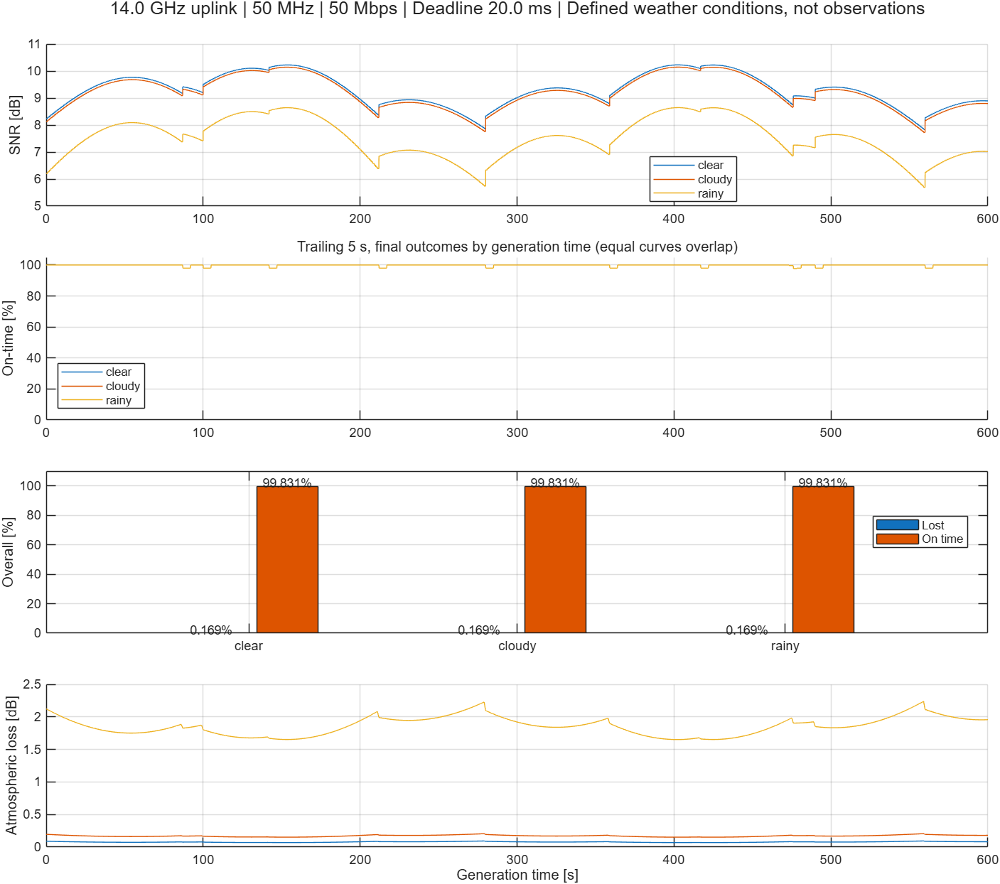

# GSL uplink — 날씨 3조건 비교

공통 RF: **Ku 14 GHz / 50 MHz 잡음 대역폭 / 50 Mbps 정보율 / QPSK·AR4JA r=1/2 k=1024**.
평가 구간은 지상국→첫 위성, 기한은 연구 가정 20ms입니다.

## 실행

이 폴더를 MATLAB Current Folder로 맞춥니다.

```matlab
B = main_gsl_weather_comparison;
```

맑음(clear)·흐림(cloudy)·비(rainy)의 600초 결과를 동일한 위성 기하·트래픽으로 계산합니다. 결과는 results_weather의 각 조건 폴더와 weather_comparison.csv/.png에 저장합니다.

기존 3D 기본 재생·일시정지·배속과 번호별 패킷 창은 조건 하나를 선택해서 실행합니다.

```matlab
R = main_gsl_simulation(configGSL('clear'));
R = main_gsl_simulation(configGSL('cloudy'));
R = main_gsl_simulation(configGSL('rainy'));
```

한 번에 원하는 한 줄만 실행합니다. main_gsl_simulation만 실행하면 맑음입니다.

## 날씨 모델과 해석

[기상 입력·ITU 수식·한계·출처](WEATHER_MODEL.md)를 확인하세요. P.676 기체·P.840 구름·P.838 비 흡수를 층별 경로에 적용합니다. 기본 강우율은 0/0/10mm/h이며 구름 액체 수분 밀도는 0/0.5/0.5g/m³입니다. 실제 관측 날짜를 불러온 실측이 아니라 명시한 기상 조건에 대한 전파 모델입니다. 인공 10dB 감쇠와 임의 잡음은 세 날씨 실행에서 꺼져 있습니다.



현재 RF 설정은 신호 여유가 커서 세 조건 모두 손실 61개, 기한 내 도착률 99.830556%입니다. 날씨별 평균 감쇠·SNR은 다릅니다. 높은 SNR의 CWER는 공개 곡선 끝값을 쓰는 근사이므로 작은 차이를 오류율로 구분하지 못합니다. 같은 손실률을 일반적인 실제 기상 환경의 동일 성능이라고 해석하지 않습니다.

## 지표와 패킷 창

- 손실률 = 최종 미도착 원본 수 / 전체 생성 수 × 100
- 기한 내 도착률 = 생성 후 GSL 기한 안에 첫 위성에 도착한 수 / 생성 수 × 100
- 기한 내 전달 실패율 = (손실 + 늦은 도착) / 생성 수 × 100
- 연속 손실은 원본 패킷 ID 순서로 집계합니다.
- 검은 박스=기한 내 도착, 흰색=손실, 주황=늦은 도착, 회색=처리 중/미생성. 번호를 누르면 위성·위치·원인·시각이 표시됩니다.
- 성능 그래프 세 번째 패널은 최근 5초 생성 패킷의 기한 내 도착률입니다. 생성 시각으로 묶은 최종 결과이며 실시간 처리 중 상태와 구분합니다.

results_weather/<조건>/packet_results.csv, loss_runs.csv, weather_attenuation.csv, weather_inputs.json과 그래프를 확인하세요. ISL 인계 파일은 isl_input_packets.csv입니다. 과거 results_packets는 인공 감쇠 시험 기록이며 최신 날씨 결과가 아닙니다.

검증: verify_uplink, verify_weather. [검증 결과](validation_weather.md). 실제 UDP 소켓·ML·전력 제어·복제 전송·혼잡 큐는 아직 포함하지 않습니다.
