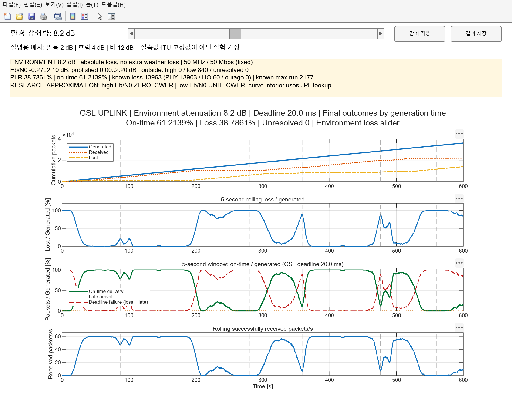

# GSL — 환경 감쇠 슬라이더

**main_gsl_simulation.m을 열고 F5**로 실행합니다. 지구본/3D 창은 열리지 않습니다. 위성 궤도·고도각·연결 위성·핸드오버는 내부에서 계산하며 결과 그래프와 번호별 패킷 창만 표시합니다.

성능 창 상단의 **환경 감쇠량 0~20 dB** 슬라이더를 움직이고 놓으면 해당 값이 그대로 적용됩니다. 기본 시작값은 2 dB이며 0.1 dB 단위입니다. 기존 날씨 선택 메뉴와 세 날씨 표, 추가 감쇠 모드는 기본 화면에서 제거했습니다.

설명용 예시: **맑음 2 dB / 흐림 4 dB / 비 12 dB**. 이는 사용자가 제시한 시나리오 예시이며 실제 날씨의 관측값이나 ITU 권고 고정값이 아닙니다. 슬라이더로 연속적인 환경 감쇠 민감도를 실험합니다.

## 계산

`수신 SNR = 환경 손실 적용 전 링크 버짓 SNR - 슬라이더 환경 감쇠량`

슬라이더 값이 전체 환경 감쇠입니다. 기존 기체·구름·강우 감쇠를 다시 더하지 않습니다. 자유공간 경로 손실과 고정 구현 손실은 링크 버짓에 그대로 유지됩니다. 주파수 14 GHz / 잡음 대역폭 50 MHz / 정보율 50 Mbps / QPSK·AR4JA r=1/2, k=1024 조건입니다. 트래픽 160 Bytes·60pps·600초, GSL 도착 기한 20ms, 핸드오버 중단 100ms는 기존 실험 가정입니다.

SNR → 정보 Eb/N0 → JPL Figure 14 CWER → `PER=1-(1-CWER)^2`를 사용합니다. **곡선보다 낮은 Eb/N0는 PER=1, 높은 Eb/N0는 PER=0으로 근사**하여 슬라이더 전 범위를 계산합니다. 곡선 내부는 논문 표 보간, 양 끝은 강화학습 비교를 위한 연구 가정입니다. [근사 규칙·민감도 실험·그래프 연동](PHY_APPROXIMATION.md).
## 패킷과 저장

- 검은 박스=20ms 내 도착, 흰색=손실, 주황=늦은 도착, 회색=처리 중·미생성·모델 미확정. 패킷 번호를 클릭하면 구분됩니다.
- 패킷 창에서 재생/일시정지·배속·시각 이동을 할 수 있습니다. 감쇠를 바꿔도 재생 시각은 유지됩니다.
- 감쇠값은 600초 전체에 일정하게 적용하여 다시 평가합니다. 시각별 날씨 관측이나 실시간 날씨 변화 재현이 아닙니다.
- **결과 저장** → `results_attenuation/loss_<값>_dB/`의 CSV·MAT·요약·성능 이미지. 최초 실행 결과는 기본 2dB 폴더에 저장됩니다.
- 전체 PLR = `(생성 - 최종 수신) / 생성 × 100`. 원인별 합산 검증 = `(PHY + 핸드오버 + 연결 불가 손실) / 생성 × 100`. 모든 결과가 확정됐을 때 동일합니다.
- 정상 입력의 기본 근사 모델에서는 모든 패킷의 최종 결과를 계산합니다. 잘못되거나 누락된 PHY 입력은 여전히 미확정으로 남깁니다.

이번 버전에는 큐·배경 트래픽·ACM·ML·복제 전송은 포함하지 않습니다. 과거 results_weather와 extra_* 폴더는 이전 실험 기록입니다. compareGSLWeather 등은 과거 기상 프로필 비교용으로 남아 있으며 기본 main에서는 호출하지 않습니다.

검증: `verify_environment_slider`, `verify_attenuation_slider`, `verify_saturation_sweep`. [검증 기록](validation_saturation.md).

