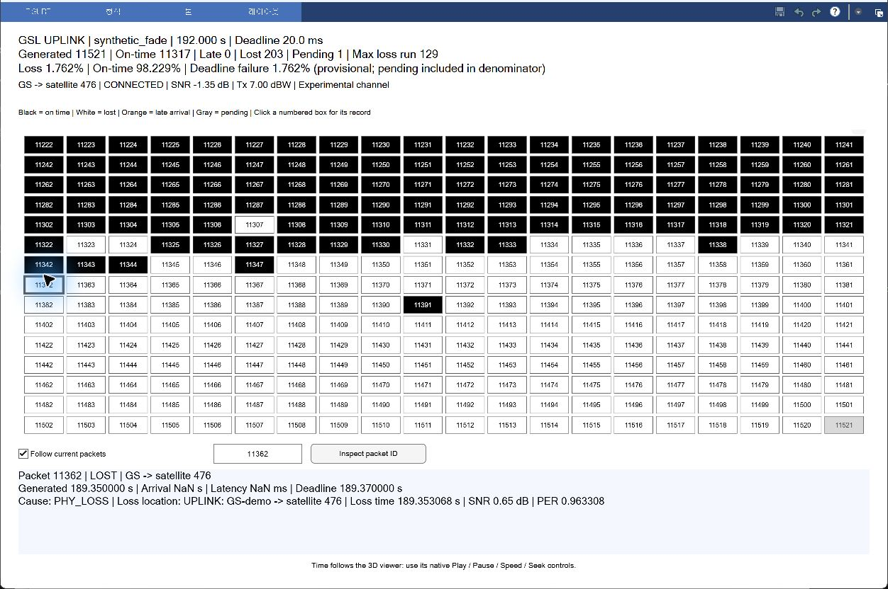
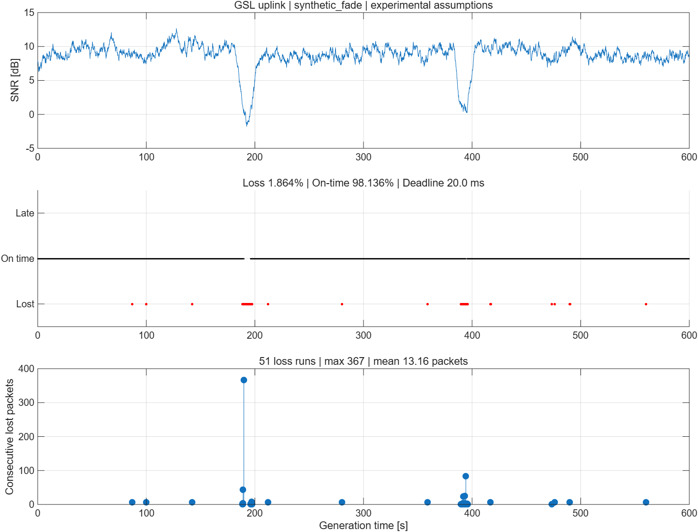

# GSL uplink 패킷 시뮬레이터

**최신 실행 파일: `main_gsl_simulation.m`** (2026-10-29)

평가 구간은 **지상국 → ISL에 진입하는 첫 번째 위성**입니다. ISL 내부와 목적지 downlink는 포함하지 않습니다.

MATLAB Current Folder를 이 폴더로 맞춘 뒤:

```matlab
R = main_gsl_simulation;
```

1. 600초·1,584개 위성의 기하와 패킷 결과를 계산합니다.
2. 기존 3D 창의 기본 재생/일시정지/배속/시간 이동을 사용합니다.
3. 별도 패킷 창은 3D 시간을 따릅니다. 각 박스의 번호를 누르면 원인과 위치를 확인합니다.

검정=기한 내 도착, 흰색=최종 손실, 주황=늦은 도착, 회색=처리 중/미생성입니다.

**기본 `synthetic_fade`는 신호 약화 기능 검증용 인공 감쇠 시험이며, 실측 손실률을 재현한 모델이 아닙니다.** `configGSL.m`에서 `channelScenario='clear'`로 바꾸면 인공 감쇠를 제외한 비교가 가능합니다. GSL 기한 20ms와 RF/채널 값은 연구용 가정입니다.

[실행·지표·가정·저장 파일 상세](GSL_UPLINK_GUIDE.md)

- 손실률 = 미도착 원본 수 / 생성 수 × 100
- 기한 내 도착률 = GSL 기한 내 도착 원본 수 / 생성 수 × 100
- 기한 내 전달 실패율 = (손실 + 지각) / 생성 수 × 100
- 연속 손실은 원본 ID 순서로 집계합니다.

`results_packets`에 모든 패킷 기록, 연속 손실 구간, ISL 인계용 도착 패킷, 요약과 그래프를 저장합니다. 팀원의 ISL 코드는 수정하지 않습니다. 실제 UDP 소켓·ML·전력 조절·복제 전송·혼잡 큐는 아직 구현되지 않았습니다.

검증: `verify_uplink`

패킷 번호 선택 예시(192초 시점, 전체 600초 최종 지표와 구분):




