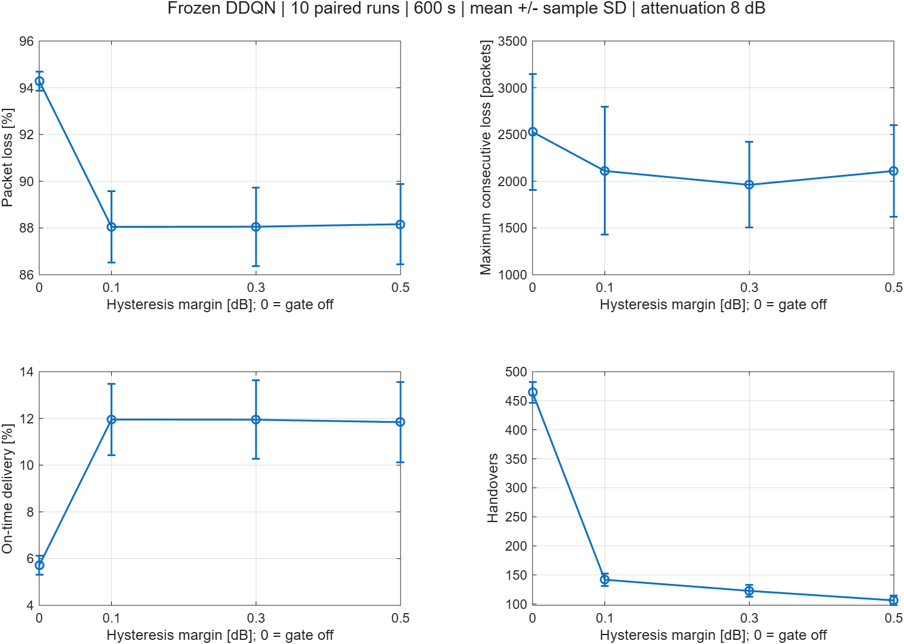

# 히스테리시스 4조건 × 10회 비교 결과

실행일: 2026-11-15. 기존 저장 DDQN 모델을 재학습하지 않고 현재 6×11 이동 격자에서 평가했다. 한 회차 600초, 패킷 36,000개, 환경감쇠 8 dB다. 모델: results_ddqn/20261112_163509_823/agent.mat.

0 dB는 전환 조건 OFF다. 양수 마진에서는 DDQN이 제안한 위성이 현재 연결보다 지정한 dB 이상 좋을 때만 전환한다. 기존 위성이 보이지 않으면 마진 없이 새 연결을 허용한다. 같은 회차의 네 조건은 동일한 SNR·패킷 난수를 사용했다.

아래는 **10회 평균 ± 표본 표준편차**다. 최대 연속 손실은 각 600초 실행의 최댓값을 구한 뒤 그 10개를 평균했다.

| 마진 | 패킷 손실률 (%) | 최대 연속 손실 (개) | 20 ms 내 도착률 (%) | 핸드오버 (회) |
| --- | --- | --- | --- | --- |
| 0 dB / OFF | 94.291 ± 0.407 | 2527.2 ± 620.4 | 5.709 ± 0.407 | 464.2 ± 17.4 |
| 0.1 dB | 88.048 ± 1.517 | 2110.2 ± 683.9 | 11.952 ± 1.517 | 141.8 ± 10.5 |
| 0.3 dB | 88.056 ± 1.683 | 1961.5 ± 458.6 | 11.944 ± 1.683 | 122.6 ± 10.6 |
| 0.5 dB | 88.161 ± 1.714 | 2110.4 ± 490.6 | 11.839 ± 1.714 | 106.2 ± 8.5 |

## 해석

- 히스테리시스를 적용한 세 조건 모두 기본 DDQN보다 평균 손실률과 연속 손실이 낮고 핸드오버도 적었다.
- 0.1 dB의 평균 손실률이 가장 낮지만 0.3 dB와 차이는 약 0.008%p다. 이 작은 차이만으로 더 좋은 모델이라고 결론 내리지 않는다.
- 0.3 dB는 이번 10회에서 평균 최대 연속 손실이 가장 짧았다. 연속 손실을 줄이는 연구 목표에 맞춰 추가 검증할 후보로 볼 수 있다.
- 0.5 dB는 전환이 가장 적지만 손실률과 평균 최대 연속 손실이 더 좋아지지는 않았다. 핸드오버 횟수만으로 마진을 선택하면 안 된다.
- 전체 손실률이 여전히 약 88~94%로 높다. 이번은 이전 환경에서 저장한 모델을 변경된 이동 격자에 적용한 결과다. 새 환경에서의 재학습이나 링크 조건 검토 없이 기존 팀원 실험 결과와 직접 비교하지 않는다.

## 검증과 파일

40회 모두 미확정 패킷 0개이며, `(생성-수신)`과 `(PHY+핸드오버+연결불가 손실)`이 일치했다. 24,000개의 매초 선택 기록에서 실제 핸드오버, 마진 조건, 차단된 ID 선택을 별도 검증했다. 100 ms 핸드오버마다 6개 손실이 발생하는 현재 모델의 계산도 일치했다. 평균·표준편차 역시 저장된 회차별 CSV와 대조했다.

작은 공유용 결과: [회차별 결과](results_hysteresis/reference_20261115/runs.csv), [요약](results_hysteresis/reference_20261115/summary.csv), [기본 DDQN 대비 같은 시드별 차이 요약](results_hysteresis/reference_20261115/paired_changes_vs_no_gate.csv).

바탕화면 전체 결과는 codex/1110/gsl/results_hysteresis/20261115_042204_077 폴더에 있다. comparison.png 그래프, MATLAB figure, 40개 선택 기록과 첫 회차의 패킷별 결과를 포함한다.

단일 저장 모델·동일 이동 궤적에서 10개 난수 시드를 비교한 실험이다. 다른 궤적·환경감쇠·재학습 시드에 대한 일반화나 통계적 유의성을 확정한 결과는 아니다.
